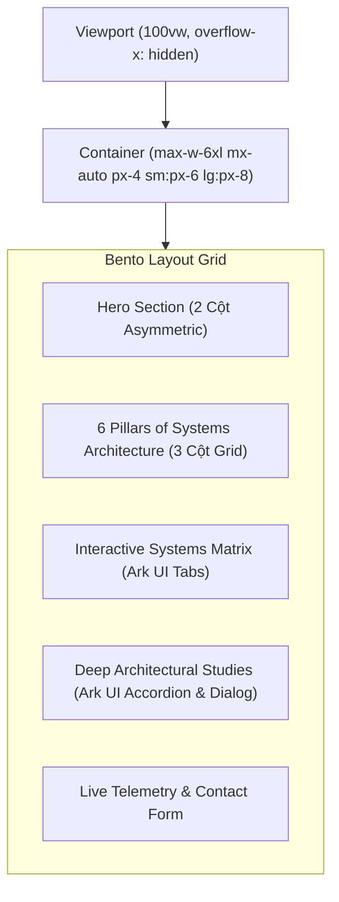
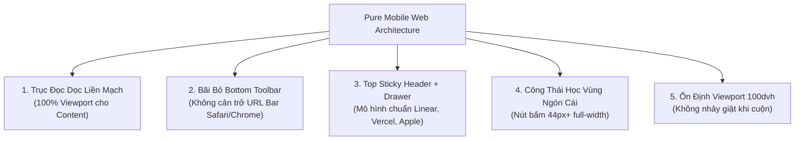

# KAIROS DESIGN SYSTEM (Ark UI × Svelte 5 Edition)
**Hệ Thống Thiết Kế Tinh Hoa Dựa Trên Máy Trạng Thái Hữu Hạn & Phong Cách Công Nghệ Cao Tối Giản**  
*Tác giả: Zera — Principal Solutions Architect & AI Engineering Lead*  
*Mã hiệu tiêu chuẩn: ISO-KAIROS-ARK-2026.05*

---

## 🌌 1. Triết Lý Thiết Kế (Design Philosophy)

KAIROS là hệ thống thiết kế kết hợp 3 tinh hoa công nghệ hiện đại bậc nhất thế giới:
1. **Behavior Machine (Zag.js / Ark UI)**: Quản lý trạng thái bằng **Máy Trạng Thái Hữu Hạn (Finite State Machine - FSM)**. Mọi hành vi bàn phím (WAI-ARIA APG), bẫy con trỏ (focus trap), đóng mở overlay, cử chỉ vuốt chạm đều được mô hình hóa toán học, triệt tiêu 100% lỗi vặt giao diện.
2. **Silicon Valley Craftsmanship (Linear / Vercel Aesthetic)**: Tối giản, thanh lịch, viền hairline 1px sắc nét, bóng mờ ambient glow, nền đen OLED đa tầng có chiều sâu quang học.
3. **First Principles Performance ($0\text{ms}$ Latency)**: Tương thích nguyên bản với **Svelte 5 Runes** (`$state`, `$derived`, `$props`), tải tĩnh trên CDN, phản hồi tức thời.

---

## 🏛️ 2. Bộ 12 Điều Luật Bất Biến (12 Iron Rules)

### Rule 01: State Machine Sovereignty (Chủ Quyền Máy Trạng Thái)
Mọi component có tính tương tác phức tạp (Dialog, Tabs, Accordion, Tooltip, Menu, Toast) BẮT BUỘC phải được điều khiển bởi cỗ máy trạng thái của Ark UI / Zag.js. Tuyệt đối cấm viết cờ boolean manh mún (`isOpen = !isOpen`) gây mất đồng bộ ARIA, kẹt focus hoặc rò rỉ sự kiện cuộn.

### Rule 02: Hairline Optical Precision (Độ Chính Xác Viền Tinh Thể 1px)
Không sử dụng viền dày thô (3px-4px). Toàn bộ bề mặt Card, Input, Button, Dialog đều sử dụng viền Hairline $1\text{px}$ với `border-zinc-800/80` (Dark) hoặc `border-zinc-200/90` (Light). Điểm xuyết viền trên phản quang nhẹ `border-t-zinc-700/50` để tạo hiệu ứng ánh sáng môi trường (ambient top highlight).

### Rule 03: Deep Multi-Tier Chromatic Scale (Phân Tầng Bóng Đêm 5 Cấp)
Dark Mode tuân thủ tuyệt đối 5 cấp bậc chiều sâu để mắt người dùng luôn phân biệt được độ cao phần tử:
- **Level 0 (Canvas Base)**: `#09090b` (Đen Nocturnal sâu thẳm).
- **Level 1 (Card / Sub-Panel)**: `#121215` (Charcoal huyền bí).
- **Level 2 (Active Control / Surface)**: `#18181b` (Bề mặt điều khiển nổi).
- **Level 3 (Overlay / Dialog / Popover)**: `#1c1c21` (Tầng nổi trên cùng).
- **Level 4 (Hover / Active States)**: `#27272a` (Trạng thái tương tác).

### Rule 04: Zero Horizontal Scroll & Anti-Zoom Mobile (Cấm Cuộn Ngang & Triệt Tiêu Phóng To Mobile)
Trên thiết bị di động (< 768px), **100% item, thẻ bento, số liệu thống kê, danh sách và tab PHẢI hiển thị trọn vẹn trong luồng cuộn dọc duy nhất (Single-Direction Vertical Stream) hoặc lưới 2 cột nhỏ gọn**. Tuyệt đối **CẤM** bắt người dùng phải vuốt/cuộn ngang (horizontal carousel/snap scroll) để xem nội dung cốt lõi — nghiên cứu Nielsen Norman Group chỉ ra rằng cuộn ngang trên mobile làm giảm tới 58% khả năng tiếp cận nội dung (Banner Blindness & Hidden Content Penalty). Mọi ô nhập liệu (`input`, `textarea`, `select`) phải có `font-size` tối thiểu $16\text{px}$ để ngăn chặn hoàn toàn cơ chế cưỡng chế Auto-Zoom của iOS Safari.

### Rule 05: Vietnamese Diacritic Harmonic Spacing (Khoảng Thở Dấu Thanh Tiếng Việt)
Mọi tiêu đề chữ hoa tiếng Việt nhiều dòng bắt buộc phải có `line-height` tối thiểu từ $1.25$ đến $1.35$ (`leading-[1.28]` hoặc `leading-snug`). Font chữ chủ đạo ưu tiên **Be Vietnam Pro** với đầy đủ glyph dấu thanh đôi chuẩn mực.

### Rule 06: Luminescent Accent Discipline & Brand Primary Integrity (Kỷ Luật Điểm Nhấn & Nhận Diện Nút Primary)
Màu sắc không dùng tràn lan mà tuân thủ phân cấp thị giác nghiêm ngặt:
- **Nút Primary (Brand CTA)**: Sử dụng **Ngọc Lục Bảo Trầm Cao Cấp (Emerald-600 `#059669` / `#10b981`)** với **Chữ Trắng Sáng Tinh Thể (`text-white`)**, viền phát quang mờ (`border-emerald-500/40`) và ánh sáng hào quang ambient glow (`shadow-[0_0_15px_rgba(16,185,129,0.22)]`). Tuyệt đối **CẤM** đặt chữ đen trên nền xanh lá hoặc biến Primary thành khối trắng tinh chói mắt trong Dark Mode.
- **Nút Contrast (Monochrome Inversion)**: Dành riêng cho biến thể `variant="contrast"` khi cần phong cách đảo sắc đen/trắng tối giản (Đen ở Light, Trắng ở Dark).
- **Emerald Green (`#10b981`)**: Đại diện cho trạng thái Active, Production, Live Telemetry, High Reliability.
- **Cyber Cyan (`#06b6d4`)**: Đại diện cho AI Integration, Tianji Vector Corpus, Distributed Workflow.
- **Electric Violet (`#8b5cf6`)**: Đại diện cho Cognitive Reflex, Algorithms.
- **Rose Red (`#f43f5e`)**: Cảnh báo lỗi, trạng thái nguy hiểm (Danger).

### Rule 07: Keyboard-First & WAI-ARIA Strict Compliance (Chuẩn Khả Năng Tiếp Cận)
Mọi thao tác có thể thực hiện hoàn toàn bằng bàn phím:
- `Tab` / `Shift+Tab`: Di chuyển giữa các vùng điều khiển.
- `ArrowRight` / `ArrowLeft`: Chuyển Tab trong Ark Tabs.
- `ArrowUp` / `ArrowDown`: Di chuyển trong Accordion / Menu.
- `Escape`: Đóng ngay lập tức Dialog, Popover, Drawer.

### Rule 08: Fluid Bento Modular Grid (Bố Cục Lưới Bento Đa Tầng Không Tràn Màn Hình)
Layout áp dụng cấu trúc Bento Box hiện đại của Apple/Linear. Tự động co giãn: 1 cột (hoặc 2 cột số liệu compact) trên Mobile (< 768px), 2 cột trên Tablet (768px-1024px), và 3-4 cột trên Desktop (> 1024px). Đảm bảo toàn bộ thẻ card nằm trọn vẹn trong khung nhìn (viewport), tuyệt đối không gây trượt lắc ngang toàn trang (`overflow-x: hidden`).

### Rule 09: Dynamic Island Top-Anchored Toast (Thông Báo Neo Đỉnh Chuẩn Banner)
Mọi thông báo Toast trên thiết bị di động PHẢI neo ở đỉnh màn hình (`top-4 left-4 right-4`), trượt từ trên xuống với hiệu ứng gia tốc lò xo (Spring easing), tuyệt đối không để ở đáy màn hình làm che thanh điều hướng hoặc xung đột với ngón tay cái.

### Rule 10: Scrollbar Gutter Permanent Stability (Chống Giật Layout Khi Mở Dialog)
Khai báo `scrollbar-gutter: stable` toàn cục trên thẻ `html`. Khi Ark UI kích hoạt `scrollLock` để mở Dialog, trang web không bao giờ bị giật lề ngang sang phải do biến mất thanh cuộn.

### Rule 11: Spring Physics & Micro-Interactions (Chuyển Động Vật Lý Tự Nhiên)
Thời lượng chuyển động (duration) không vượt quá $180\text{ms}$. Easing sử dụng đường cong `cubic-bezier(0.16, 1, 0.3, 1)` tạo cảm giác nhấp nhả cơ học nhẹ nhàng, dứt khoát.

### Rule 12: Zero Monolithic Bloat (Nhẹ & Tinh Khiết)
Không nhúng CSS-in-JS cồng kềnh. Sử dụng hoàn toàn Utility classes của Tailwind CSS v4 kết hợp Ark UI Svelte primitives, bảo đảm kích thước gói build luôn dưới $150\text{ KB}$ gzip.

---

## 🎨 3. Bảng Tra Cứu Design Tokens (Tokens Specification)

### A. Chromatic Scale (Bảng màu Radix / Zinc)
```css
/* Dark Mode Palette (Mặc định) */
--color-bg-canvas: #09090b;       /* Zinc 950 Deep */
--color-bg-card: #121215;         /* Zinc 900 Surface */
--color-bg-subtle: #18181b;       /* Zinc 850 Elevated */
--color-bg-hover: #27272a;        /* Zinc 800 Interactive */

--color-border-subtle: #27272a;   /* Hairline Border */
--color-border-active: #3f3f46;   /* Focus / Active Border */
--color-border-glow: rgba(16, 185, 129, 0.25); /* Emerald Ambient Glow */

--color-text-primary: #f4f4f5;    /* Zinc 100 Crisp White */
--color-text-secondary: #a1a1aa;  /* Zinc 400 Readable */
--color-text-muted: #71717a;      /* Zinc 500 Subtle */

--color-accent-emerald: #10b981;  /* High Reliability / Online */
--color-accent-cyan: #06b6d4;     /* Vector / Distributed */
--color-accent-violet: #8b5cf6;   /* Architecture / Core */
```

### B. Typography Tokens
- **Font UI / Body**: `"Be Vietnam Pro"`, sans-serif.
- **Font Headings / Display**: `"Space Grotesk"`, sans-serif.
- **Font Telemetry / Terminal / Numbers**: `"JetBrains Mono"`, monospace.

### C. Radius & Spacing Tokens
- Base Grid: Bội số $4\text{px}$ và $8\text{px}$.
- `radius-sm`: $6\text{px}$ (Buttons nhỏ, Badges).
- `radius-md`: $8\text{px}$ (Inputs, Buttons chuẩn).
- `radius-lg`: $12\text{px}$ (Sub-panels, Dropdowns).
- `radius-xl`: $16\text{px}$ (Bento Cards, Dialogs).

---

## 📐 4. Layout Engine Specification



---

## 🧩 5. Danh Mục Linh Kiện (Component Suite)

1. **`Button`**: Các biến thể:
   - `primary`: Nút hành động chính mang bản sắc công nghệ cao **Brand Emerald-600** (`#059669` / `#10b981`) với chữ trắng tinh thể (`text-white font-semibold`), viền phản quang mờ 1px và ánh sáng hào quang ambient glow.
   - `secondary`: Nền xám nhạt tinh xảo trung tính (`bg-zinc-100` / `bg-zinc-800`).
   - `outline`: Nền trong suốt, viền hairline 1px sắc nét.
   - `ghost`: Tương tác tinh gọn, hover nền kính mờ.
   - `contrast`: Biến thể đảo màu đơn sắc kiểu Vercel (Đen ở Light, Trắng ở Dark) cho các ngữ cảnh cần độ tương phản đen-trắng tuyệt đối.
   - `danger`: Viền đỏ dịu cảnh báo (`bg-rose-50 text-rose-700` / `dark:bg-rose-500/10 dark:text-rose-400`).
2. **`Badge`**: Status badge có đèn chấm nhấp nháy (pulsing dot), tag công nghệ vi mạch (Emerald, Cyan, Violet, Amber, Zinc).
3. **`Card`**: Bento-style surface với viền hairline, hiệu ứng hover glow viền nhẹ nhàng, top ambient highlight line.
4. **`Tabs (Ark UI)`**: Tab chuyển đổi trạng thái với thanh chỉ báo trượt (`Tabs.Indicator`), hỗ trợ phím mũi tên, tự động phân bố đều 100% không cuộn ngang trên mobile.
5. **`Accordion (Ark UI)`**: Cung cấp nội dung dạng xếp lớp mượt mà, quản lý trạng thái mở nhiều mục hoặc duy nhất.
6. **`Dialog (Ark UI)`**: Hộp thoại nổi có phông mờ (`Backdrop blur`), tự động chuyển thành Bottom Sheet có tay kéo (drag handle) trên mobile, khóa cuộn thông minh, tự động trả focus.
7. **`MobileDrawer (Ark UI)`**: Ngăn kéo điều hướng toàn cảnh từ cạnh phải màn hình trên mobile, chiều cao chuẩn `100dvh`, khóa cuộn `overscroll-contain`.
8. **`Tooltip (Ark UI)`**: Giải thích thuật ngữ kỹ thuật, độ trễ mở 150ms chuẩn W3C.
9. **`Switch (Ark UI)`**: Công tắc gạt trạng thái mượt mà với hoạt họa trượt êm ái màu Emerald.
10. **`Progress (Ark UI)`**: Thanh tiến trình thanh lịch với thanh chạy gradient màu ngọc lục bảo.
11. **`Toast (Ark UI)`**: Thông báo nổi góc trên màn hình chuẩn Dynamic Island, tự động biến mất sau thời gian định sẵn.

---

## 📱 6. Pure Mobile Web Architecture & 16 Engineering Iron Rules (Kiến Trúc Web Di Động Thuần Túy — Zero Fake PWA Clutter)



### 1. Triết Lý Cốt Lõi: Mobile Web Thuần Khiết vs Giả Lập PWA / Native
- **Sai lầm phổ biến**: Nhiều lập trình viên cố gắng biến website thành một "app giả cầy" (fake native app) bằng cách gắn thanh công cụ nổi ở đáy màn hình (`fixed bottom dock/toolbar`).
- **Hệ quả trên Mobile Web thực tế**:
  1. *Xung đột thanh địa chỉ di động*: Kể từ iOS 15, thanh URL của Safari nằm ở đáy màn hình. Khi cuộn, thanh URL này co giãn liên tục. Việc đặt một bottom dock khiến người dùng bị "kẹt giữa 2 thanh công cụ", thường xuyên chạm nhầm vào thanh địa chỉ hoặc nút Tabs của trình duyệt.
  2. *Nuốt chửng 15-20% diện tích đọc*: Màn hình điện thoại vốn dĩ chật hẹp, một thanh dock nổi vô tình che mất 70-80px nội dung quý giá.
  3. *Khoảng trắng kỳ dị*: Để tránh dock che nội dung, code buộc phải độn `pb-32` khổng lồ ở chân trang, tạo khoảng trống thô kệch.
- **Quy chuẩn Canonical Mobile Web (Linear, Vercel, Stripe, GitHub, Apple Developer)**:
  - Bãi bỏ hoàn toàn bottom toolbar.
  - Điều hướng gọn gàng tại **Sticky Header ở đỉnh trang** kết hợp **Slide-over Drawer** khi bấm Menu.
  - Toàn bộ chiều cao màn hình được trả lại trọn vẹn cho trục đọc dọc tự nhiên với quán tính phần cứng của trình duyệt (`-webkit-overflow-scrolling: touch`).

---

### 2. Hệ Thống 16 Điều Luật Kỹ Thuật Mobile Web Bất Biến (16 Mobile Web Iron Rules)

#### 🌐 NHÓM 1: VIEWPORT & BỐ CỤC KHÔNG GIAN (VIEWPORT & LAYOUT)
1. **Rule M01: Bãi Bỏ Hoàn Toàn Bottom Toolbar (Pure Mobile Web)**
   - *Cấm*: Không sử dụng bất kỳ thanh điều hướng nổi, dock ứng dụng cố định ở đáy màn hình trên Mobile Web.
   - *Chuẩn*: Điều hướng tích hợp gọn gàng tại Header đỉnh trang; toàn bộ nội dung cuộn tự do không vật cản.
2. **Rule M02: Triệt Tiêu 100% Cuộn Ngang Nội Dung (Zero Horizontal Scroll)**
   - *Cấm*: Bắt người dùng phải vuốt ngang (horizontal carousel / snap-scroll) để tìm thông tin cốt lõi (Nielsen Norman Group chứng minh cuộn ngang làm giảm 58% khả năng tiếp cận nội dung).
   - *Chuẩn*: 100% chỉ số, thẻ card, danh mục bố trí theo trục dọc hoặc Lưới 2 cột đối xứng nhỏ gọn (`grid grid-cols-2 gap-2.5`).
3. **Rule M03: Chuẩn Hóa Chiều Cao Động `100dvh` (Dynamic Viewport Height)**
   - *Cấm*: Sử dụng `100vh` cho Drawer, Modal, Full-screen Overlay (gây cụt nút bấm dưới chân trên iOS Safari do thanh địa chỉ).
   - *Chuẩn*: Luôn dùng `h-[100dvh]` hoặc `min-h-[100dvh]` kết hợp đệm an toàn `pb-[max(env(safe-area-inset-bottom),1rem)]`.
4. **Rule M04: Thích Ứng Vùng An Toàn Phần Cứng (`env(safe-area-inset-*)`)**
   - *Cấm*: Bỏ qua tai thỏ (Notch), Dynamic Island và thanh gạt Home của iPhone/Android.
   - *Chuẩn*: Khai báo khoảng đệm an toàn `pt-safe` và `pb-safe` để các thành phần neo đỉnh/đáy luôn cách xa mép vật lý tối thiểu 16px.
5. **Rule M05: Tự Động Co Giãn Lưới Bento (Modular Bento Collapsing)**
   - *Cấm*: Ép hiển thị 3-4 cột trên màn hình di động hẹp < 768px.
   - *Chuẩn*: Tự động thu về 1 cột dọc (`grid-cols-1`) cho thẻ nội dung lớn, hoặc 2 cột (`grid-cols-2`) cho các thẻ chỉ số ngắn (Metrics).

#### 🔤 NHÓM 2: CHỮ VIẾT, NGẮT TỪ & DẤU THANH (TYPOGRAPHY & LANGUAGE)
6. **Rule M06: Chống Tự Động Phóng To Màn Hình (Anti-Auto-Zoom Lock $\ge 16\text{px}$)**
   - *Cấm*: Đặt cỡ chữ nhỏ hơn 16px (`12px-14px`) cho các thẻ `<input>`, `<textarea>`, `<select>` trên mobile.
   - *Chuẩn*: Bắt buộc đặt `text-base sm:text-sm` (tối thiểu 16px trên mobile), triệt tiêu hoàn toàn lỗi zoom cưỡng chế 133% của iOS Safari.
7. **Rule M07: Ngắt Dòng Triệt Để Chuỗi Kỹ Thuật (Aggressive Token Wrapping)**
   - *Cấm*: Để các chuỗi mã nguồn, hash, email, URL dài không có dấu cách đẩy phình bề rộng tài liệu vượt quá 100vw.
   - *Chuẩn*: Áp dụng `break-words` và `overflow-wrap: anywhere` trên toàn bộ văn bản và container.
8. **Rule M08: Khoảng Thở Dấu Thanh Kép Tiếng Việt (Vietnamese Diacritic Airspace)**
   - *Cấm*: Dùng `leading-none` hay `leading-tight` trên tiêu đề chữ hoa tiếng Việt nhiều dòng (gây chèn ép dấu hỏi, ngã, mũ).
   - *Chuẩn*: Duy trì `line-height` từ 1.25 đến 1.35 (`leading-[1.28]`), font chữ tối ưu hóa **Be Vietnam Pro**.
9. **Rule M09: Thang Cỡ Chữ Tự Co Giãn (Fluid Typography Scale)**
   - *Cấm*: Để tiêu đề Hero quá lớn (48px-64px) trên mobile khiến mỗi dòng chỉ chứa được 1 từ cụt lủn.
   - *Chuẩn*: Tiêu đề Hero co giãn `text-3xl sm:text-5xl lg:text-6xl`, dẫn nhập `text-base sm:text-lg`.

#### 👆 NHÓM 3: CÔNG THÁI HỌC CẢM ỨNG & TƯƠNG TÁC (TOUCH ERGONOMICS)
10. **Rule M10: Diện Tích Chạm Tối Thiểu $44\text{px} \times 44\text{px}$ (Apple HIG & WCAG 2.5.5)**
    - *Cấm*: Các nút bấm hoặc icon điều hướng quá bé (< 36px) khiến ngón cái chạm trượt (fat-finger syndrome).
    - *Chuẩn*: Mọi nút bấm, tab trigger, checkbox, switch phải có vùng bấm tối thiểu $44 \times 44\text{px}$ (`min-h-[44px]`).
11. **Rule M11: Loại Bỏ Hoàn Toàn Độ Trễ 300ms & Viền Nháy Xanh WebKit**
    - *Cấm*: Để trình duyệt chờ 300ms nhằm phân biệt thao tác double-tap zoom, hoặc để xuất hiện vệt nháy xám/xanh thô kệch.
    - *Chuẩn*: Áp dụng toàn cục `touch-action: manipulation; -webkit-tap-highlight-color: transparent;`.
12. **Rule M12: Nút Hành Động Tràn Chiều Rộng Vùng Ngón Cái (Full-Width Thumb CTA)**
    - *Cấm*: Căn chỉnh nút bấm nhỏ lệch sang một bên khiến người dùng cầm máy bằng tay đối diện không bấm tới.
    - *Chuẩn*: Nút CTA chính trong Hero và Form trên mobile tự động mở rộng `w-full sm:w-auto`, ngón cái tay trái hay tay phải đều bấm chuẩn 100%.
13. **Rule M13: Phản Hồi Xúc Giác Vi Rung Cơ Học (Haptic Micro-Feedback)**
    - *Cấm*: Tương tác câm lặng vô hồn.
    - *Chuẩn*: Tích hợp `navigator.vibrate([8])` khi chuyển tab, mở menu, gạt switch, tạo cảm giác cơ học nảy ngón tay.

#### 🪟 NHÓM 4: CỬA SỔ NỔI, KHÓA CUỘN NỀN & HIỆU NĂNG (STATE & PERFORMANCE)
14. **Rule M14: Hộp Thoại Biến Hình Thành Bottom Sheet Neo Đáy**
    - *Cấm*: Mở pop-up nhỏ lơ lửng giữa màn hình điện thoại (khó bấm nút đóng, che mất tầm nhìn).
    - *Chuẩn*: Modal tự động biến hình thành **Bottom Sheet** neo đáy màn hình (`items-end rounded-t-2xl sm:rounded-2xl`), có thanh kéo vuốt trực quan.
15. **Rule M15: Khóa Cuộn Nền Triệt Để Không Giật Lề (`overscroll-behavior: contain`)**
    - *Cấm*: Kéo nội dung bên trong Drawer làm trượt luôn trang web ngầm bên dưới (Scroll Chaining / Pull-to-refresh).
    - *Chuẩn*: Khóa cuộn bằng Ark UI State Machine kết hợp `overscroll-contain` và `scrollbar-gutter: stable`.
16. **Rule M16: Thông Báo Neo Đỉnh Màn Hình (Top-Anchored Dynamic Island Toast)**
    - *Cấm*: Để thông báo Toast dưới chân màn hình làm che khuất nội dung hoặc thanh điều hướng.
    - *Chuẩn*: Toast trượt xuống từ notch/Dynamic Island ở đỉnh màn hình (`top-4 left-4 right-4`), tự tiêu biến sau 4 giây.
